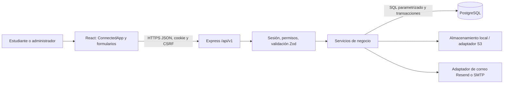

# Arquitectura implementada

React 18/Vite presenta la aplicación HTTP. Node/Express sirve frontend/dist y /api/v1 desde un mismo origen. PostgreSQL 17 conserva datos compartidos. Las imágenes se almacenan fuera de PostgreSQL: archivos locales en desarrollo y adaptador S3 preparado para producción. El modo anterior de demostración solo se selecciona explícitamente con VITE_DEMO_MODE=true.



El diagrama distingue componentes implementados de servicios externos: PostgreSQL y almacenamiento local están verificados; la conexión S3 y el transporte real de correo todavía no. Los endpoints administrativos validan el rol en el servidor. El frontend no decide identidad ni propiedad.

```text
frontend/
  src/connected/       ConnectedApp, Forms, Messenger, Operations, Admin
  src/services/        apiClient: HTTP y CSRF, sin credencial en localStorage
  src/components/      catálogo, modales, iconos y visuales compartidos
  src/AppShell.jsx     demostración anterior explícita
  e2e/                 recorridos HTTP/PostgreSQL en escritorio y móvil
backend/
  migrations/          001_initial.sql, 002_operation_amounts.sql
  src/routes/          auth, listings, conversations, operations, moderation
  src/controllers/     controladores HTTP de publicaciones
  src/services/        negocio, correo y objetos
  src/repositories/    conexiones, usuarios y publicaciones
  src/validators/      esquemas Zod y reglas de contenido
  src/middleware/      sesiones, permisos y errores
  src/models/          ejecutor de migraciones con checksum
  src/scripts/         promoción controlada de administrador
  test/                API real, concurrencia y reinicio de procesos
.github/workflows/     validación Linux con PostgreSQL y navegador
docs/                 documentación técnica vigente
entregables/entregable_final/  siete apartados y evidencias
```

## Flujos

Registro → hash Argon2id y matrícula HMAC → enlace de un uso → sesión revocable. Publicar → validar campos e imágenes → asociar referencias propias → guardar transacción. Mensajes → comprobar participación → insertar emisor de sesión → consultar historial. Solicitar → bloquear publicaciones en orden → aceptar/reservar → finalizar estado terminal → calificar. En renta, devolución explícita vuelve a disponibilidad. En intercambio, ambas publicaciones se reservan y finalizan juntas. Moderación conserva decisiones e historial.

## Decisiones y límites

Se sustituyó el JWT propuesto por sesiones opacas revocables para invalidación inmediata. Se eligió servir el cliente junto a la API para mantener cookies del mismo origen. No hay pasarela de pago, validación documental de matrícula ni GPS; la pertenencia se comprueba mediante control del correo institucional. Mensajes, operaciones y panel administrativo muestran hasta cien registros recientes; los mensajes individuales y el catálogo sí tienen paginación. El perfil carga hasta cincuenta publicaciones recientes. La administración completa de registros antiguos requiere ampliar esos listados antes de escalar el servicio.

El modelo SQL real se documenta en [DATABASE.md](DATABASE.md); las rutas en [API.md](API.md). No existen microservicios ni capas de almacenamiento remoto desplegadas en esta ejecución.
