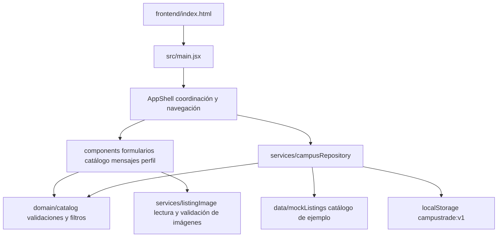

# Estructura funcional de CampusTrade

La versión 0.2.0 es una aplicación React con persistencia local. El catálogo de demostración permite recorrer los flujos sin servidor. Las publicaciones nuevas, favoritos, conversaciones, perfil y reportes se guardan en el navegador que los creó.



## Organización

```text
package.json                 Comandos desde la raíz y workspace frontend
package-lock.json            Versiones reproducibles para npm ci
.github/
  workflows/                 Pruebas y despliegue manual a Pages
  ISSUE_TEMPLATE/            Formulario de bugs
  pull_request_template.md   Requisitos para revisar cambios
frontend/
  index.html                 Entrada de Vite
  vite.config.js             Desarrollo compilación y ruta de publicación
  vitest.config.js            Pruebas de dominio repositorio e interfaz
  playwright.config.js        Recorridos reales en escritorio y móvil
  e2e/                       Pruebas del compilado
  src/
    main.jsx                 Montaje de React
    App.jsx                  Exportación de la aplicación
    AppShell.jsx             Estado navegación y coordinación de operaciones
    components/              Catálogo modales formularios mensajes y perfil
    domain/                  Catálogos normalización filtros y validaciones
    data/                    Datos iniciales de demostración
    services/                Persistencia repositorios y lectura de imágenes
    test/                    Preparación del entorno de pruebas
docs/                        Avance incidencias validación y colaboración
entregables/evidencias/       Capturas reales obtenidas con Playwright
```

## Reglas implementadas

- Título de 8 a 100 caracteres, descripción de 20 a 1500 y punto de entrega de 3 a 120. Se recortan espacios.
- Venta y renta requieren un precio positivo, con hasta dos decimales y un máximo de 1 000 000 MXN. Donación e intercambio guardan importe cero.
- Imágenes opcionales JPG, PNG o WebP de hasta 500 KB; se verifica tipo y firma del archivo.
- Búsqueda sin distinguir acentos o mayúsculas; filtros acumulables por categoría, carrera, modalidad, condición, disponibilidad y precio. Para renta se usa la tarifa por día.
- Edición y cambios de estado únicamente sobre las publicaciones del perfil local. Finalizado es un estado terminal.
- Una conversación por publicación; los mensajes vacíos o de más de 2000 caracteres se rechazan.
- Un reporte abierto por publicación. Motivo obligatorio y descripción de 10 a 1000 caracteres.
- Cada escritura conserva un único documento de estado versionado. Si el almacenamiento falla, la interfaz informa el error y conserva el formulario. Los datos dañados no se sobrescriben sin confirmación de restablecimiento.
- El evento `storage` actualiza otras pestañas del mismo origen. Esto no ofrece transacciones concurrentes ni sincronización entre usuarios.

## Alcance pendiente

La autenticación institucional, permisos del servidor, base de datos compartida, entrega de mensajes, moderación, calificaciones y pagos requieren backend. Los controles locales de propiedad organizan la demostración; no sustituyen autorización de servidor. La interfaz identifica expresamente el modo local y los datos de ejemplo.

Los documentos Word y PDF de fase 2 se conservan como antecedentes. Este archivo describe la implementación actual.
