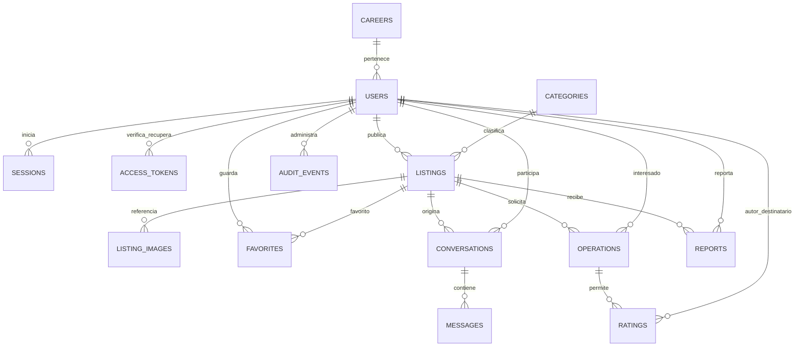

# Base de datos y migraciones

PostgreSQL 17 real, no almacenamiento del navegador. `001_initial.sql` crea catorce tablas de negocio; `schema_migrations` registra versiones. `002_operation_amounts.sql` amplía el importe a bigint para rentas de hasta noventa días. UUID, claves foráneas, CHECK de rangos, unicidad de email/matrícula HMAC, índices de participantes y favoritos preservan integridad.

Los precios se guardan en centavos; las fechas de renta son DATE y la API devuelve YYYY-MM-DD. Fechas de eventos usan timestamptz. No se guardan binarios de imágenes ni contraseñas en claro. listing_images contiene propietario, publicación, object_key, tipo y tamaño. La tabla operations referencia publicación principal, solicitante y oferta opcional; ratings infiere el destinatario desde la operación.

La aceptación bloquea filas de publicaciones en orden UUID dentro de una misma conexión y transacción. El índice parcial one_accepted_operation_idx complementa las reglas del servicio. Se rechazan solicitudes incompatibles; los terminales no se reabren. Retirar una oferta cancela solicitudes pendientes relacionadas. Eliminar imágenes pendientes bloquea su fila antes de borrar la referencia, evitando competir con su asociación a una publicación.

El ejecutor toma bloqueo asesor, normaliza CRLF/LF para el checksum, aplica migraciones pendientes en transacción y rechaza cambios a archivos aplicados. Ejecutar `npm run migrate` o `npm start` (migra antes de escuchar). Para cambios posteriores crear otra migración; no editar 001 ni 002.

Desarrollo: Docker, puerto 127.0.0.1:55432, volumen campustrade_postgres_data. Las pruebas rechazan hosts remotos, crean un esquema test_UUID por suite y eliminan solo ese esquema y sus archivos. La prueba persistence.test.js inicia dos procesos Node sucesivos y comprueba publicación y sesión conservadas. No demuestra todavía recuperación ante pérdida de disco o restauración de backup.

Respaldo operativo: `pg_dump --format=custom` hacia un archivo fuera de Git usando DATABASE_URL solo desde el entorno; guardar también objetos e inventario. Probar `pg_restore` primero en una base nueva, verificar migraciones/health y los flujos antes de cambiar el servicio. No usar docker compose down -v para reiniciar. No se ejecutó restauración productiva ni existe una base remota creada.
