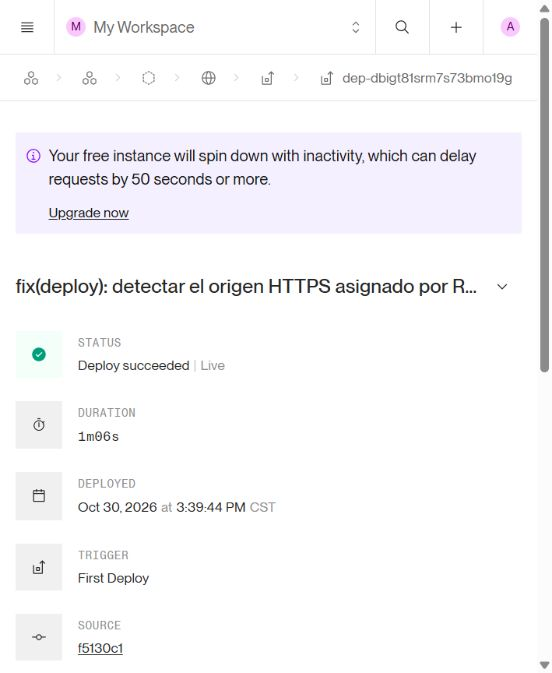
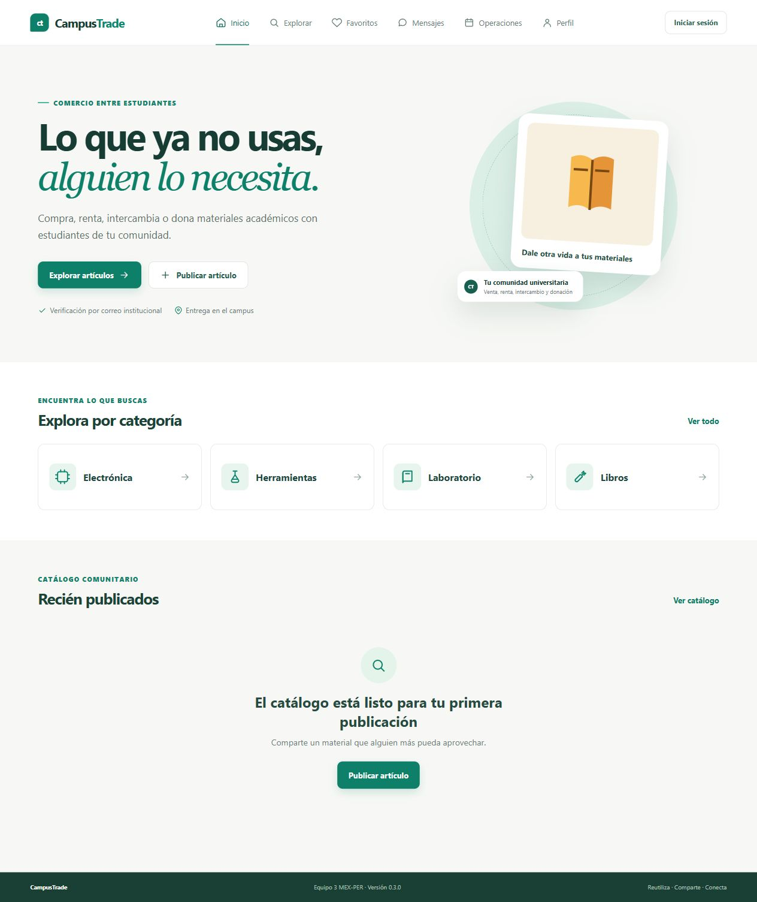

# Release y despliegue real

**Criterio 7: CUMPLIDO.** [Abrir CampusTrade](https://campustrade-mex-per.onrender.com/) · [Health de API](https://campustrade-mex-per.onrender.com/api/v1/health). Frontend y backend HTTPS 200; health status=ok, database=connected, versión base 0.3.0.

Primer despliegue real: **30-10-2026 15:40:50 UTC−06** (21:40:50Z), Render Free `campustrade-mex-per`, servicio `srv-dbigt7hsrm7s73bmnvn0`, despliegue `dep-dbigt81srm7s73bmo19g`, SHA `f5130c1f6dc30961969a9b42f3765dfae96060b4`. Build `npm ci --include=dev && npm run build`, inicio `npm start`; compilación y arranque correctos. [Panel del despliegue](https://dashboard.render.com/web/srv-dbigt7hsrm7s73bmnvn0/deploys/dep-dbigt81srm7s73bmo19g).

Neon Free conserva PostgreSQL 17, migraciones 001/002 y datos. Supabase Free conserva imágenes en bucket privado de 5 MB/image-webp. Se comprobaron TLS/certificado, 15 tablas, índices y restricciones; primero se ensayaron migraciones idempotentes en una rama aislada. Los secretos se guardaron únicamente en backend/Render y configuración privada excluida de Git.

Validación inicial: **28 comprobaciones HTTPS correctas**, incluyendo registro sintético sin verificación, login, cookie segura, sesión, CSRF y permisos; [resultado](evidencias/despliegue/https-before.json). La prueba del adaptador backend S3, desde un cliente local autorizado contra Supabase real, obtuvo GET firmado 200, anónimo 403 y WebP/hash coincidentes; [resultado](evidencias/despliegue/storage-create.json). No equivale a un recorrido productivo de publicación por alumno verificado. El [perfil público](evidencias/despliegue/campustrade-perfil-no-verificado.jpg) mantiene la verificación pendiente.

Versión candidata siguiente: **v0.3.0-rc.2**, base de paquetes 0.3.0, documentada en CHANGELOG. Se conserva [v0.3.0-rc.1](https://github.com/JoshStra/Compraventa_Peru_Mexico/releases/tag/v0.3.0-rc.1), publicada sobre addc154 el 30-10-2026 a las 17:07:25Z; su tag no se mueve. El registro final de publicación conserva el SHA y enlace de la nueva candidata cuando quede publicado.

**Pendientes explícitos:** proveedor/remitente de correo por decisión del responsable; prueba consentida con alumno real; recorridos productivos que exigen verificación; PR con revisión independiente; donación dedicada y restauración de respaldo. No se verificaron cuentas artificialmente ni se enviaron correos. No se contrató un servicio de pago. Las capturas desktop/mobile anteriores siguen siendo pruebas locales.

[Recursos y mantenimiento](../../docs/DEPLOYMENT.md) · [Pruebas](../../docs/TESTING.md) · [Google Docs](https://docs.google.com/document/d/1h3fI6tzXEtdbv4iEQHsKf1KkHpNK_m08HOVxQkKW9W8/edit) · [PDF](CampusTrade_Entregable_Final.pdf).
