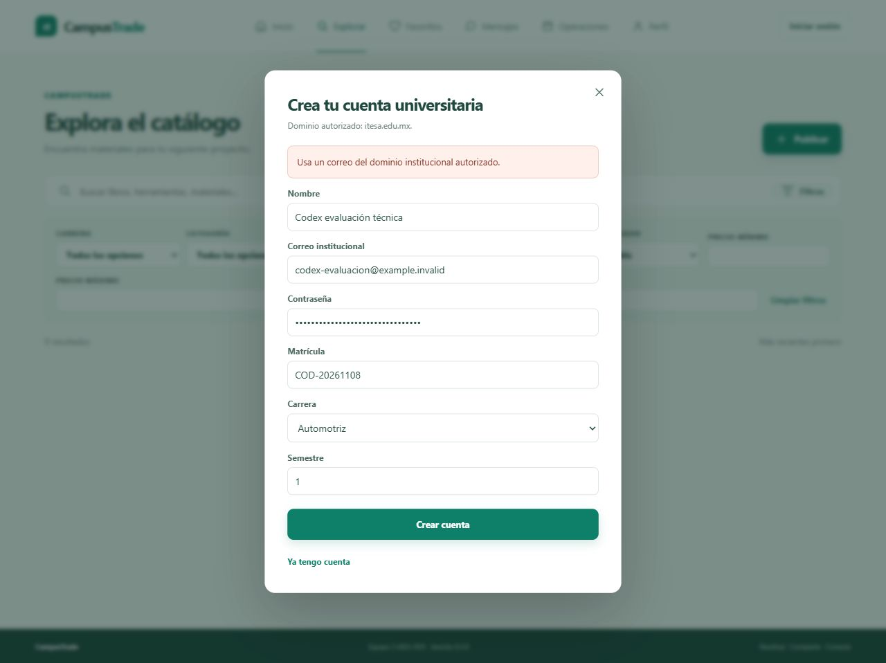
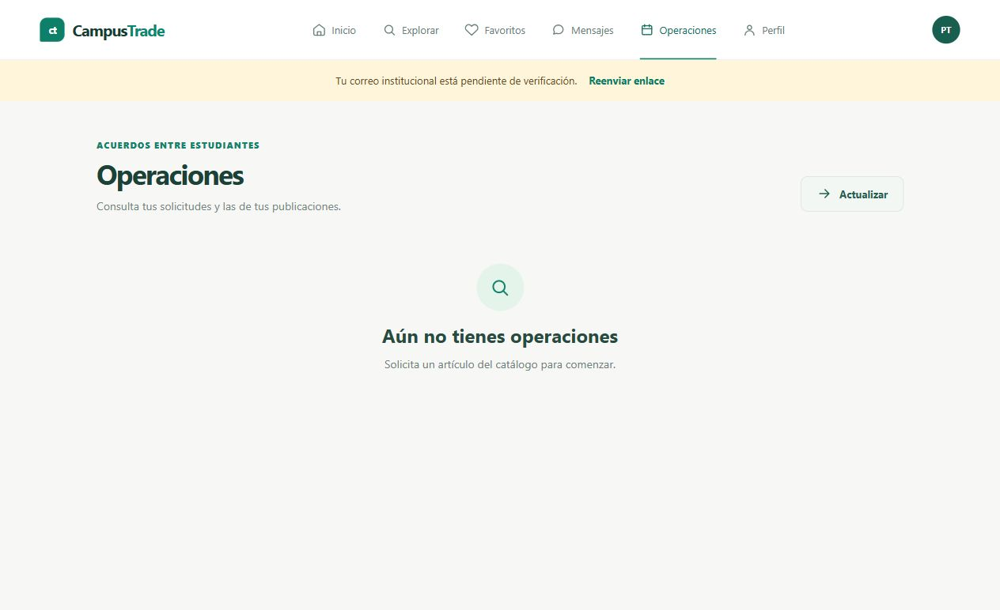

# Evidencia de interacción y comentarios de Codex

**Estado: DOCUMENTADO POR CODEX. Evaluador: Codex, agente de IA. Comprobaciones exploratorias: 13. Comentarios propios: 13.** La sesión se realizó por solicitud del responsable sobre [CampusTrade público](https://campustrade-mex-per.onrender.com/), con versión visible 0.3.0. No se incorporan participantes humanos nuevos.

La bitácora registra observaciones entre **2026-11-08T12:30:45-06:00** y **2026-11-08T12:36:45-06:00**, zona America/Mexico_City. Las marcas corresponden al momento de documentar cada observación, no a una medición de duración de cada clic. Se usó la cuenta sintética preexistente y se cerró la sesión al terminar. Las credenciales están excluidas de estas evidencias.

Se revisaron portada, búsqueda, filtros, teclado, dominio institucional, acceso, perfil, bloqueo de publicación, favoritos, mensajes, operaciones, recarga de sesión, salida y consola. Resultado: doce comprobaciones aprobadas y una aprobada con observación por el arranque inicial de Render. No se detectaron errores de consola en la sesión; la portada observada no tuvo desbordamiento horizontal a 1280 x 720.

## Registro de la sesión

| ID | Módulo | Estado |
| --- | --- | --- |
| COD-01 | Acceso e inicio | APROBADA CON OBSERVACIÓN |
| COD-02 | Búsqueda del catálogo | APROBADA |
| COD-03 | Filtros y recuperación | APROBADA |
| COD-04 | Acceso y teclado | APROBADA |
| COD-05 | Registro institucional | APROBADA |
| COD-06 | Inicio de sesión y perfil | APROBADA |
| COD-07 | Publicación y permisos | APROBADA |
| COD-08 | Favoritos | APROBADA |
| COD-09 | Mensajes | APROBADA |
| COD-10 | Operaciones | APROBADA |
| COD-11 | Sesión después de recargar | APROBADA |
| COD-12 | Cierre de sesión y acceso privado | APROBADA |
| COD-13 | Presentación y consola | APROBADA |

Los comentarios siguientes son observaciones de Codex obtenidas al operar la interfaz. Se entregan como evaluación técnica del agente, según lo solicitado. El catálogo estaba vacío y la cuenta continuó sin verificar: esta sesión no acredita compras, mensajes entre dos estudiantes, publicación productiva ni envío real de correo. El catálogo de 97 casos del 7 de noviembre conserva su corte y sus resultados; las trece comprobaciones exploratorias de esta sesión se registran aparte.

## Comentarios y resultados

## COD-01 Acceso e inicio

**Comentario de Codex:** La propuesta de venta, renta, intercambio y donación es clara en la portada. La espera inicial de Render puede confundir a quien entra por primera vez; conviene avisarla antes de una demostración.

**Acción realizada:** Abrir la URL pública y observar el arranque hasta ver la página de inicio.

**Resultado esperado:** Acceder a CampusTrade con navegación y acciones principales.

**Resultado obtenido:** Apareció primero la pantalla de arranque de Render; después cargó CampusTrade 0.3.0 con Inicio, Explorar e Iniciar sesión.

**Estado y fecha:** APROBADA CON OBSERVACIÓN · 2026-11-08T12:30:45-06:00 · UTC 2026-11-08T18:30:45.967Z.

**Evidencia:** [COD-01.txt](evidencias/sesion_codex_2026-11-08/COD-01.txt) · [COD-01.jpg](evidencias/sesion_codex_2026-11-08/COD-01.jpg).

## COD-02 Búsqueda del catálogo

**Comentario de Codex:** El estado sin resultados es claro y ofrece una forma de recuperarse. El catálogo está vacío, por lo que en esta sesión no pude valorar tarjetas ni detalles de productos.

**Acción realizada:** Entrar a Explorar y buscar calculadora.

**Resultado esperado:** Mostrar coincidencias o un estado vacío explicativo.

**Resultado obtenido:** Se muestran 0 resultados, No encontramos artículos y el botón Limpiar búsqueda y filtros.

**Estado y fecha:** APROBADA · 2026-11-08T12:31:04-06:00 · UTC 2026-11-08T18:31:04.533Z.

**Evidencia:** [COD-02.txt](evidencias/sesion_codex_2026-11-08/COD-02.txt) · [COD-02.jpg](evidencias/sesion_codex_2026-11-08/COD-02.jpg).

## COD-03 Filtros y recuperación

**Comentario de Codex:** Los filtros cubren criterios útiles y la acción de limpieza funciona. Como el catálogo no contiene artículos, solo pude comprobar cambios de controles y estados vacíos, no la exactitud de coincidencias.

**Acción realizada:** Combinar Herramientas, Renta y precios de 100 a 300; pulsar Limpiar búsqueda y filtros.

**Resultado esperado:** Cambiar criterios y recuperar valores iniciales al limpiar.

**Resultado obtenido:** La categoría y modalidad vuelven a Todas las opciones, la búsqueda y los importes quedan vacíos; se conserva Disponible como filtro inicial.

**Estado y fecha:** APROBADA · 2026-11-08T12:31:24-06:00 · UTC 2026-11-08T18:31:24.711Z.

**Evidencia:** [COD-03.txt](evidencias/sesion_codex_2026-11-08/COD-03.txt) · [COD-03.jpg](evidencias/sesion_codex_2026-11-08/COD-03.jpg).

## COD-04 Acceso y teclado

**Comentario de Codex:** El recorrido básico con teclado es cómodo: Escape permite salir y el foco regresa al botón de acceso. Esta comprobación puntual no equivale a una auditoría completa de accesibilidad.

**Acción realizada:** Abrir Iniciar sesión, comprobar foco del correo y pulsar Escape.

**Resultado esperado:** Foco inicial en correo; cierre con Escape y retorno al botón que abrió el modal.

**Resultado obtenido:** Foco inicial en correo: true. Foco restaurado en Iniciar sesión: true. El diálogo desaparece.

**Estado y fecha:** APROBADA · 2026-11-08T12:31:44-06:00 · UTC 2026-11-08T18:31:44.738Z.

**Evidencia:** [COD-04.txt](evidencias/sesion_codex_2026-11-08/COD-04.txt).

## COD-05 Registro institucional

**Comentario de Codex:** El dominio autorizado se informa antes del envío y el rechazo se entiende. El mensaje general podría señalar también el campo Correo institucional para localizar antes el problema.

**Acción realizada:** Completar el registro con datos de prueba y correo example.invalid; intentar Crear cuenta.

**Resultado esperado:** Rechazar el dominio ajeno y explicar el dominio permitido.

**Resultado obtenido:** El formulario permanece abierto y muestra Usa un correo del dominio institucional autorizado; arriba indica itesa.edu.mx.

**Estado y fecha:** APROBADA · 2026-11-08T12:32:33-06:00 · UTC 2026-11-08T18:32:33.516Z.

**Evidencia:** [COD-05.txt](evidencias/sesion_codex_2026-11-08/COD-05.txt) · [COD-05.jpg](evidencias/sesion_codex_2026-11-08/COD-05.jpg).

## COD-06 Inicio de sesión y perfil

**Comentario de Codex:** El acceso ofrece un estado Procesando y después permite consultar el perfil. La verificación pendiente queda visible; conviene explicar ahí el siguiente paso disponible mientras no se active el correo.

**Acción realizada:** Iniciar sesión con la cuenta sintética existente y abrir Perfil.

**Resultado esperado:** Mostrar la identidad de prueba y conservar su estado sin verificar.

**Resultado obtenido:** La sesión abre el perfil Prueba técnica de despliegue, con VERIFICACIÓN PENDIENTE, cero publicaciones y cero operaciones finalizadas.

**Estado y fecha:** APROBADA · 2026-11-08T12:33:16-06:00 · UTC 2026-11-08T18:33:16.632Z.

**Evidencia:** [COD-06.txt](evidencias/sesion_codex_2026-11-08/COD-06.txt).

## COD-07 Publicación y permisos

**Comentario de Codex:** El bloqueo protege la publicación y explica las acciones restringidas. El aviso debería acompañarse de una alternativa útil, como volver al catálogo, mientras no se habilite el envío de verificación.

**Acción realizada:** Desde Perfil pulsar Publicar artículo con la cuenta sin verificar.

**Resultado esperado:** Mantener bloqueada la publicación y explicar el motivo.

**Resultado obtenido:** Se muestra Verifica tu correo institucional antes de publicar, escribir o solicitar una operación; no se abre el formulario.

**Estado y fecha:** APROBADA · 2026-11-08T12:33:51-06:00 · UTC 2026-11-08T18:33:51.637Z.

**Evidencia:** [COD-07.txt](evidencias/sesion_codex_2026-11-08/COD-07.txt).

## COD-08 Favoritos

**Comentario de Codex:** La explicación del estado vacío y el botón para explorar son útiles. No pude comprobar agregar o quitar artículos porque no hay publicaciones en el catálogo.

**Acción realizada:** Abrir Favoritos con la cuenta de prueba.

**Resultado esperado:** Mostrar la lista propia o un estado vacío con una salida útil.

**Resultado obtenido:** La pantalla muestra Aún no hay favoritos, Guarda los artículos que quieras revisar después y el botón Explorar artículos.

**Estado y fecha:** APROBADA · 2026-11-08T12:34:16-06:00 · UTC 2026-11-08T18:34:16.841Z.

**Evidencia:** [COD-08.txt](evidencias/sesion_codex_2026-11-08/COD-08.txt) · [COD-08.jpg](evidencias/sesion_codex_2026-11-08/COD-08.jpg).

## COD-09 Mensajes

**Comentario de Codex:** La pantalla explica el siguiente paso y recuerda que la entrega se acuerda dentro del campus. Esta sesión solo valida la navegación y el estado vacío; no el intercambio de mensajes.

**Acción realizada:** Abrir Mensajes sin conversaciones previas.

**Resultado esperado:** Mostrar un estado vacío y cómo iniciar una conversación.

**Resultado obtenido:** Se muestran Aún no tienes conversaciones, la indicación de abrir un artículo y Explorar artículos.

**Estado y fecha:** APROBADA · 2026-11-08T12:34:27-06:00 · UTC 2026-11-08T18:34:27.446Z.

**Evidencia:** [COD-09.txt](evidencias/sesion_codex_2026-11-08/COD-09.txt) · [COD-09.jpg](evidencias/sesion_codex_2026-11-08/COD-09.jpg).

## COD-10 Operaciones

**Comentario de Codex:** El estado vacío se entiende y existe actualización manual. Desde esa pantalla sería útil un acceso directo al catálogo, además de la indicación de solicitar un artículo.

**Acción realizada:** Abrir Operaciones y pulsar Actualizar operaciones.

**Resultado esperado:** Consultar la lista propia y mostrar un estado vacío si no existen solicitudes.

**Resultado obtenido:** La consulta termina con Aún no tienes operaciones y Solicita un artículo del catálogo para comenzar; el botón de actualización sigue disponible.

**Estado y fecha:** APROBADA · 2026-11-08T12:35:20-06:00 · UTC 2026-11-08T18:35:20.380Z.

**Evidencia:** [COD-10.txt](evidencias/sesion_codex_2026-11-08/COD-10.txt) · [COD-10.jpg](evidencias/sesion_codex_2026-11-08/COD-10.jpg).

## COD-11 Sesión después de recargar

**Comentario de Codex:** La sesión se conserva al recargar, lo que evita repetir el acceso durante la navegación. La identidad y el estado de verificación se mantienen visibles en el perfil.

**Acción realizada:** Recargar la página autenticada y abrir de nuevo Perfil.

**Resultado esperado:** Conservar la sesión de prueba y su estado institucional.

**Resultado obtenido:** El perfil vuelve a mostrar Prueba técnica de despliegue y VERIFICACIÓN PENDIENTE sin pedir otro login.

**Estado y fecha:** APROBADA · 2026-11-08T12:36:14-06:00 · UTC 2026-11-08T18:36:14.849Z.

**Evidencia:** [COD-11.txt](evidencias/sesion_codex_2026-11-08/COD-11.txt).

## COD-12 Cierre de sesión y acceso privado

**Comentario de Codex:** La salida se confirma y el acceso privado vuelve a pedir identificación. El comportamiento es consistente y evita que la lista privada quede accesible tras salir.

**Acción realizada:** Cerrar sesión y después intentar abrir Favoritos.

**Resultado esperado:** Salir de la cuenta y exigir acceso para volver a la lista privada.

**Resultado obtenido:** Se muestra Sesión cerrada, vuelve Iniciar sesión y al abrir Favoritos aparece el diálogo de acceso.

**Estado y fecha:** APROBADA · 2026-11-08T12:36:44-06:00 · UTC 2026-11-08T18:36:44.776Z.

**Evidencia:** [COD-12.txt](evidencias/sesion_codex_2026-11-08/COD-12.txt) · [COD-12.jpg](evidencias/sesion_codex_2026-11-08/COD-12.jpg).

## COD-13 Presentación y consola

**Comentario de Codex:** La portada se ajusta a la anchura observada y la consola no registró errores durante la sesión. Esta revisión corresponde a esa vista y no certifica todos los tamaños o dispositivos.

**Acción realizada:** Al terminar la navegación, revisar errores de consola y anchura del documento en la vista actual.

**Resultado esperado:** No registrar errores de consola ni desbordamiento horizontal en la portada revisada.

**Resultado obtenido:** Errores de consola: 0. Vista 1280 x 720; ancho del documento 1265.

**Estado y fecha:** APROBADA · 2026-11-08T12:36:45-06:00 · UTC 2026-11-08T18:36:45.114Z.

**Evidencia:** [COD-13.txt](evidencias/sesion_codex_2026-11-08/COD-13.txt) · [COD-13.jpg](evidencias/sesion_codex_2026-11-08/COD-13.jpg) · [consola-y-layout.json](evidencias/sesion_codex_2026-11-08/consola-y-layout.json).

## Mejoras propuestas a partir de la sesión

- COD-01: avisar de la espera inicial antes de una demostración del alojamiento gratuito.
- COD-05: asociar el error de dominio también al campo Correo institucional.
- COD-06 y COD-07: explicar un siguiente paso útil mientras el envío institucional siga pendiente.
- COD-10: ofrecer un botón para volver al catálogo desde el estado vacío de operaciones.

Estas son recomendaciones de la evaluación; no se declaran implementadas ni corregidas en el código durante esta sesión. Los bloques institucionales se mantuvieron activos.

## Capturas de esta sesión

La [bitácora completa de Codex](evidencias/sesion_codex_2026-11-08/sesion_codex.json) contiene autor, fecha, módulo, acción, esperado, obtenido, estado, comentario y archivos de evidencia. Hay trece snapshots de las comprobaciones, nueve capturas y un registro de consola y geometría. Los snapshots del perfil están sanitizados.

## Registro complementario para sesiones con personas

Participantes humanos documentados: 0. El formulario editable al final del PDF sigue disponible para incorporar sesiones adicionales. Los comentarios de esta entrega pertenecen a Codex; no se atribuyen a un estudiante ni a un evaluador humano.
